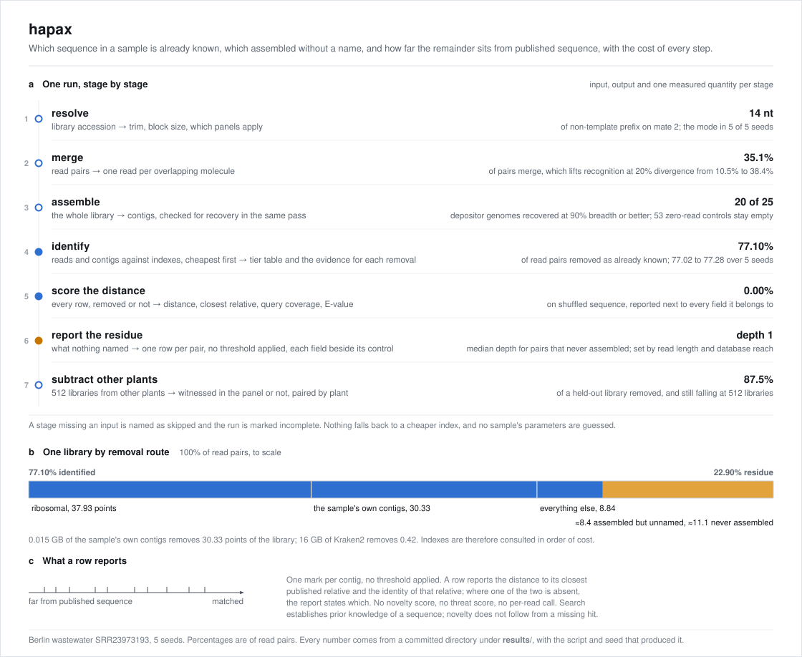

# hapax

Finds the viruses in wastewater that sit far from anything published.



hapax removes the reads a library's reference databases already explain, assembles the
remainder, and reports every contig as a distance to its closest published relative: which
relative, over how much of the contig, and at what significance.

| Class | Contents |
|---|---|
| **A** | Contigs at real distance from anything published |
| **B** | Novel strains of named viruses |
| **C** | Unplaced sequence, reported with the depth it was seen at |

Known viruses are recognised out to about 10% divergence, fading by 20%. Detection needs
abundance above roughly one in a million.

## Install

```
conda env create -f environment.yml && conda activate hapax
pip install .
```

That installs the Python side and the external binaries hapax drives, pinned in
[`TOOLS.md`](TOOLS.md). The unit suite needs none of them:

```
python3 -m pip install -r requirements.txt && python3 -m pytest
```

## Reference databases

```
hapax fetch-db --all --dest data/db
```

Downloads SILVA, the four Kraken2 databases, the two protein indexes and Pfam-A, and
prints the `[databases]` table to paste into a run configuration. Every download is
recorded in `fetch_manifest.json` with its URL, byte count and digest, because which index
a run consulted is half of what its removal fraction means. SILVA is checked against the
byte count in [`data/MANIFEST.md`](data/MANIFEST.md) and a mismatch stops the fetch: a
changed release is a changed operating point. The current-release pointers have their
identity recorded instead, since no stable archive URL exists for them. Three keys cannot be
fetched and are refused with that reason, because the run produces them from the reads it
was given.

`hapax fetch-db --dry-run --all` prints the inventory, the URLs and which sizes are
asserted, and downloads nothing.

## Run

```
hapax run --config run.toml --out RUNDIR --report
```

One TOML file carries the inputs, the databases, the operating points and the library's
own facts. A value that is a property of one sequencing run, such as the mate-2 trim, is
either measured by the run or stated in the configuration with how it was established;
there is no default, because a trim of 14 applied to a library with no non-template prefix
deletes fourteen real bases from every mate in the direction of less recognition.

```
hapax stages --config run.toml    # the stages, their order and what each fills
hapax report RUNDIR               # rebuild the page from a finished run
```

The report refuses to build when a section has no file behind it, so a page that renders
is a page whose every section came from this run. `--allow-partial` builds anyway and
marks the page as incomplete.

## More

- [`SPEC.md`](SPEC.md): the spec, with the bounds on every claim
- [`results/README.md`](results/README.md): every experiment, failures included, plus the
  two archived earlier directions (codon-aware assembly, strain separation)
- [`CLAUDE.md`](CLAUDE.md): how to work in the repo
