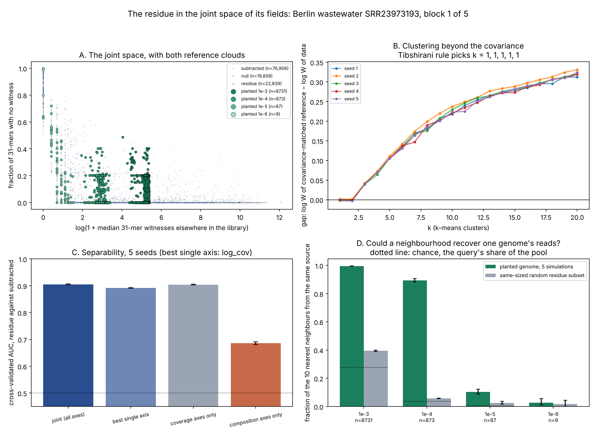

# Is the residue structured or diffuse?

The gate experiment named in [`SPEC.md`](../../SPEC.md) §4.2. Nothing downstream of the
signal-versus-noise framing was to be built until this had an answer, and a clean negative
was an allowed outcome.

**The answer is split, and the split is the result.**

1. **The residue cloud has no clusters of its own.** Against a reference drawn with the
   residue's own mean and covariance, no number of clusters is preferred over one, in five
   seeds out of five.
2. **The joint space buys 0.013 of AUC over the best single axis**, and the axis it beats is
   partly definitional. Multidimensionality is not what separates residue from known.
3. **But one genome's reads do find each other locally**, at a strength that falls off an
   order of magnitude above the abundance wall: a planted genome's reads are 99.6% of their
   own neighbours at 1 in 1,000 of the library, 89.4% at 1 in 10,000, 10.4% at 1 in 100,000
   against a 2.5% residue control, and indistinguishable from the control at 1 in a million.

So: do not build a clustering of the residue; do build the neighbourhood query, and state
that it dies by 1 in 100,000. The two walls in §7 are unmoved, and this measures where a
third one is.

Run: `experiments/residue_structure.py` (prep), `experiments/kmer_coverage/` (Rust, exact
whole-library counting), `experiments/residue_structure_analyse.py`,
`experiments/residue_structure_points.py`, `experiments/residue_structure_figure.py`.
Data: Berlin wastewater SRR23973193, all 8,731,224 pairs for counting, five 100,000-pair
blocks at skip (seed−1)×1.5 M as the query populations — the same blocks and the same
residue membership as the re-cut cascade in `results/subtract_recut/`.

## 1. The space

Eleven axes per read pair. Five are new and are the reason this experiment could say
anything the earlier ones could not:

| axis | what it is |
|---|---|
| `log_cov` | log(1 + median 31-mer witnesses **elsewhere** in the library) |
| `cov_spread` | log2 of the q90/q10 ratio of that coverage within the pair |
| `zero_frac` | fraction of the pair's 31-mers witnessed nowhere else |
| `mate_disagree` | \|log2\| ratio of the two mates' median coverage |
| `cov_step` | largest within-read coverage step over any breakpoint ≥20 k-mers from the ends |

Six are the fields the per-read report already carries: `gc`, `entropy3`, `CpG_oe`,
`UpA_oe`, `homopolymer`, `mean_error_prob`.

The coverage axes are not simply more fields. Each noise source breaks a different one of
them — an instrument error kills the ~31 k-mers spanning it on one mate only; a joined
library molecule puts its two halves at different depths; a molecule present once has no
witnesses at all, evenly. That is the mechanism §4.2 predicted would separate biology from
noise jointly where no threshold separates them singly.

Counting is exact, not sketched: every canonical 31-mer of every query read counted over the
whole library, with each pair's own occurrences subtracted so a count means *witnesses
elsewhere*. 1,439 of 568,500 pairs carry fewer than 40 scorable 31-mers (a short mate or
N-rich sequence) and are dropped rather than imputed.

### The reference clouds

- **subtracted** — every pair in the same block the cascade did identify (76,906 in block 1).
- **shuffled null** — residue mates doublet-shuffled by an Eulerian walk, so GC and CpG/UpA
  are preserved exactly, scored against the library but never added to it.
- **planted** — reads simulated off human rhinovirus A1B (D00239), absent from this sample's
  assembly and the only clean holdout of the spike ladder, with this library's measured
  insert distribution (median 194, p95 363) and error rates (0.00089 R1, 0.00117 R2), at
  four abundances with **five independent simulations each**. Each simulation is its own
  25%-substituted copy, so arms share no 31-mers (0.75³¹ ≈ 1e-4) and cannot witness each
  other; all arms are added to the library pass, so a planted read is witnessed exactly as
  often as its abundance implies.

**The shuffled null is degenerate on the coverage axes and that is worth stating**: any
shuffle destroys every 31-mer, so a null read has no witnesses by construction
(`zero_frac` 0.9999) and collapses into the corner of the space. It calibrates composition
and nothing else. A calibration that cannot discriminate is still the honest calibration of
the field.

## 2. Separability: the joint space against one axis

Residue against subtracted, logistic regression, five-fold cross-validated, mean over five
seeds with the spread across seeds:

| space | AUC |
|---|---|
| all eleven axes | **0.9053** (0.9042–0.9077) |
| best single axis (`log_cov`) | 0.8921 (0.8911–0.8934) |
| the five coverage axes | 0.9043 (0.9030–0.9068) |
| the six composition and quality axes | 0.6864 (0.6783–0.6914) |

Per-axis AUC, seed 1: `log_cov` 0.892, `cov_step` 0.780, `mate_disagree` 0.762, `cov_spread`
0.767, `zero_frac` 0.617, `entropy3` 0.683, `UpA_oe` 0.618, `gc` 0.525, `CpG_oe` 0.521,
`homopolymer` 0.519, `mean_error_prob` 0.507.

Two readings, and both matter.

**The composition axes are confirmed dead, jointly and not only singly.** Six fields
together reach 0.686; the four that PR #8 killed individually are still near 0.5 each. This
is the first time they have been given a chance *together* and they do not take it.

**The gain from joining the axes is 0.013 of AUC, and the comparator is confounded.** The
cascade subtracted the sample's own assembled contigs, and assembly needs depth, so residue
reads are low-coverage partly by definition. `log_cov` is therefore scoring a property the
subtrahend partly created, and the right reading of 0.892 is a ceiling on that confound
rather than a discovery. What survives the confound is the composition arm at 0.686 and the
shape axes (`cov_step`, `mate_disagree`, `cov_spread`), which describe *how* coverage is
distributed rather than how much of it there is.

## 3. Clustering: nothing beyond the covariance

k-means for k = 1…20 on the z-scored residue cloud, with log within-cluster dispersion
compared against ten parametric bootstraps drawn with the residue's **own mean and
covariance** (Tibshirani's gap, with the multivariate-normal reference). The covariance-
matched reference is the point of the test: a dozen correlated fields manufacture apparent
clusters when they are one measurement wearing a hat, and this removes exactly that.

- Gap at k = 1 and k = 2: −0.0015 and −0.0017 in seed 1, |gap| below s_k in every seed. The
  residue is not two groups, and it is not three (gap 0.041 at k = 3, against s_k 0.0026 —
  statistically non-zero but a twentieth of the k = 20 value).
- Tibshirani's rule picks **k = 1 in all five seeds**.
- The gap then rises monotonically to 0.33 at k = 20 with no knee anywhere. Monotone rise
  without a plateau is the signature of a smooth density being described more finely, not of
  a cluster count the data prefers. Reported here rather than stopped at k = 8, because
  stopping early would have let the curve be read as a plateau it does not have.

**The residue is a continuum.** Any design that expects to carve it into piles and name them
is working against this measurement.

## 4. The planted control: a genome finds itself, down to about 1 in 100,000

The operational form of "a cluster that behaves like a genome": pool a planted arm with the
residue cloud of block 1 and ask what fraction of each planted read's 10 nearest neighbours
come from the same source. Chance is the query's share of the pool. The control is a random
residue subset of the same size, which is the no-structure case measured rather than
assumed. Mean over five simulations, range in brackets:

| abundance | pairs | planted, all axes but quality | random residue subset | chance |
|---|---|---|---|---|
| 1e-3 | 8,731 | **0.9959** (0.9949–0.9966) | 0.3960 (0.3899–0.3995) | 0.277 |
| 1e-4 | 873 | **0.8940** (0.8822–0.9079) | 0.0578 (0.0553–0.0597) | 0.037 |
| 1e-5 | 87 | **0.1041** (0.0885–0.1218) | 0.0248 (0.0172–0.0368) | 0.004 |
| 1e-6 | 9 | 0.0267 (0.0111–0.0556) | 0.0178 (0.0000–0.0444) | 0.0004 |

Split by axis group, the kinship is mostly coverage: at 1e-4, coverage-only purity is 0.918
and composition-only 0.292. At 1e-5 both are thin (0.061 and 0.040) and only the full space
holds 0.104, a factor of 4.2 over its control and 27 over chance. At 1e-6 nine pairs cannot
resolve anything and the arm overlaps its control.

**Where the signal comes from, stated plainly.** A genome's reads share an abundance and a
composition, and those are what the neighbourhood sees; it does not see sequence identity or
mate linkage. So this measures the weakest version of the claim — a genome recognising
itself through nothing but its depth and its base composition — and that version holds to
1e-4 and is nearly gone at 1e-5. A method that used linkage would start from a better place.

## 5. Two confounds found in this experiment's own first pass

Both inflated the result in the same direction and both are fixed in the committed code;
they are recorded because the pre-fix numbers were posted to the thread before they were
caught.

1. **A constant quality value labelled the planted reads.** The simulator writes no quality
   string, so every planted and shuffled read carried the same `mean_error_prob`, which the
   neighbourhood test could use as a free identifier. The planted readouts now run in spaces
   that exclude that axis. Pre-fix 1e-5 purity read 0.448 against the 0.104 above.
2. **Nearest-neighbour ties were broken by array order.** These axes are exactly degenerate
   for a pair with no witnesses anywhere, so thousands of reads share one coordinate, and
   scikit-learn returns neighbours in index order — which handed every tie to whichever
   population was stacked first. The pool is now permuted before the query. This inflated
   the *control* as well, which is how it was caught: a random residue subset was reading as
   if it clustered.

## 6. What this says about the spec

- **§4.2's first experiment is answered.** The joint space is worth measuring and worth
  drawing, but not as a clustering: the residue is one continuum, and the deliverable view
  of §8.3 should present it as a density with reference clouds, which is what it is, rather
  than as groups with labels.
- **Of the five coverage axes, the one worth adding to the per-read report is
  `mate_disagree`**, as the error-floor estimator of §4.2's fourth axis. `cov_step` and
  `cov_spread` are strong (0.78, 0.77 AUC) but familiarity-signed and their power vanishes
  once the sample's own contigs are subtracted (§6b), so they describe a read without
  pointing anywhere useful. That is a sharper recommendation than this report first made,
  and it is the sibling thread's ladder that sharpened it.
  `cov_step`, `mate_disagree` and `cov_spread` are cheap (one exact counting pass over this
  library, a few minutes of a single core), carry 0.76–0.78 AUC each, and describe failure
  modes the report has no field for. `cov_step` is a candidate for the junction the
  split-mapping chimaera field of §4.1 tries to see at a 26% false-positive rate, and needs
  no database — but it has not been calibrated against known chimaeras here, so it is a
  candidate and not a replacement. It should also not be read as implying there are
  chimaeras to find: the `subtract the known` thread's contig-level test, which is the
  answerable form of the question, fires on 0% of unidentifiable and 0% of identified
  contigs ≥500 nt once the query's own entry is excluded. On this library the junction
  `cov_step` would be looking for appears to be rare, and the axis earns its 0.780 AUC some
  other way — most likely coverage that is genuinely uneven along a read.
- **A third wall, measured.** Recognition stops between 10% and 20% divergence; detection is
  not available below about one in a million; and *grouping a genome by its joint-space
  neighbourhood* stops by one in 100,000. The last of those is new, and it sits an order of
  magnitude above the abundance wall, so for the band between them a read's neighbours carry
  nothing and only the read itself does.
- **Nothing here moves the two existing walls.** It was not able to, and §7 should not be
  edited.

## 6b. What `cov_step` is, after a prediction of mine failed

The report above offered `cov_step` as a candidate junction detector and guessed that it
marks a molecule spanning an abundant and a rare region. **That prediction was tested by the
`subtract the known` thread and it failed.** Joining this experiment's
`coverage_axes_s1.tsv` to that thread's per-read contig depths
(`results/cov_step_join/` on `claude/project-thread-eswrkj`): among the 938 residue pairs
whose two mates map to *different* contigs, `cov_step` against the absolute log2 ratio of
the two contigs' depths is **+0.011 (CI −0.054 to +0.075)**. Flat. The pooled correlation
over all 6,834 mapped pairs is +0.160, but `cov_spread` (+0.159) and `mate_disagree`
(+0.128) are the same size, so that number is the mixture talking rather than the axis.

So what is it? Two more columns from the same exact counting pass answer most of it: the
longest run of consecutive unwitnessed 31-mers in each mate, and the step recomputed after
dropping unwitnessed k-mers. For the 4,290 residue pairs of block 1 with `cov_step` ≥ 2:

- **45% have no unwitnessed k-mer at all**, so their step cannot be a gap of any kind;
- **72% keep a step ≥1 after every unwitnessed k-mer is dropped**, so the step is a change
  of depth among k-mers that are all present elsewhere;
- **20.4% carry a zero-run of 25–40 k-mers**, the signature of a single substitution error
  destroying the k-mers that span it, against 7.1% of residue pairs generally. So errors
  contribute a real minority and not the bulk.

`cov_step` is therefore mostly a genuine change of depth *within one 107 nt read*, and it is
not the contig-level abundance boundary I guessed. The remaining explanation was sequence
shared with other molecules — a segment inside a read having more witnesses than its
neighbours without the molecule changing — and **the `subtract the known` thread has now
tested it and it holds** (`results/cov_step_conservation/`, same 22,839 pairs). Counting
distinct contigs of the sample's own assembly a read aligns to at 30 matching bases,
`cov_step` correlates +0.577, and it survives the obvious confound: within quartiles of
`log_cov` it is +0.447, +0.389, +0.392, +0.242, so it is not abundance wearing a hat.
High-step pairs align to 2.23 distinct contigs on average against 0.65, and 24.1% have a
real alignment to a *second* contig against 4.1%. The ribosomal version of the hypothesis
fails: weak SILVA similarity correlates +0.030 pooled and dies inside `log_cov` quartiles,
so the 388-fold conservation multiplier of `results/rrna_content/` is not the mechanism.

**That settles the polarity, and the polarity is bad news for the field.** A measurement
that fires on sequence shared between molecules is a *familiarity* field, not a novelty one —
the same inversion this project has met before, where score tracks database proximity rather
than newness. `cov_step` still separates residue from subtracted at 0.780 AUC, so it carries
something; it simply does not carry "this is new". The same holds for `cov_spread` (+0.580)
and `mate_disagree` (+0.564), whose pooled correlations are the same size, so this is a
property of the coverage-shape family rather than of `cov_step` alone. Read §6's
recommendation with that attached: these axes belong in the report as description, and not
as anything that points towards novelty.

The prediction is kept in this report rather than quietly replaced, because the project's
record of what it predicted wrongly is the part that makes the rest readable.

**The mechanism check, run and passed.** If coverage shape measures witnesses, its power
should *fall* as the subtrahend grows, because a bigger index removes the witnessed material
first — and it must be checked inside a fixed coverage band, because the overall number
would fall for the trivial reason that a bigger index removes high-coverage reads. The
cascade thread ran exactly that (`results/shape_axis_ladder/`, joining
`coverage_axes_allpairs_s1.tsv.gz` on 99,745 of 100,000 pairs). Inside a band fixed once at
rung zero (log_cov 3.95–6.50), `cov_step` goes from 0.317 [0.309–0.324] against SILVA alone
to **0.494 [0.480–0.509] — chance** once the sample's own identified contigs are subtracted,
and `cov_spread` from 0.201 to 0.458. Meanwhile the *overall* AUC of both strengthens, which
is the `log_cov` confound behaving exactly as predicted. The shape axes' power lives in the
witnessed material and leaves with it. (The in-band unidentified arm falls to 1,592 pairs at
that rung, so the claim rests on it and the rung beyond is a direction only.)

**`mate_disagree` is a different animal, and it is the one axis of mine worth keeping.** It
barely moves inside the band (+0.013 against −0.200 overall), so subtraction does not take
its signal away. Measured here on block 1: it is not read-length asymmetry (ρ = 0.114 with
|n₁−n₂|) and not zero-runs (ρ = −0.043 with the longest run). What it mostly is, is
**asymmetric absence** — 38.2% of pairs with `mate_disagree` ≥ 2 have exactly one mate
entirely unwitnessed while the other is witnessed, against 7.0% of residue pairs generally.
That is the signature §4.2's fourth axis already wants: instrument error is independent
between mates, organism-level absence is shared. So `mate_disagree` belongs in the report as
a per-sample error-floor estimator, which is novelty-neutral, and not in the coverage-shape
family, which is familiarity-signed.

## 7. Limitations

- One sample, one city, one preparation, as everything in this repo is.
- Residue membership is inherited from the cascade, so every confound in the subtrahend is
  inherited too — the `log_cov` confound above is the sharp one.
- The planted genome is a real genome at a real abundance, but its reads are simulated under
  uniform error with no quality model; the ladder is ordinal.
- Neighbourhood purity uses depth and composition only. Mate linkage and sequence identity,
  which an assembler would use, are deliberately not in the space, so these numbers are a
  floor on what a linkage-aware method could recover.
- `experiments/field_independence.py` on the sibling branch measures the correlation
  structure and effective dimensionality of the *report's* fields; that is the other half of
  §4.2 and is deliberately not duplicated here.
